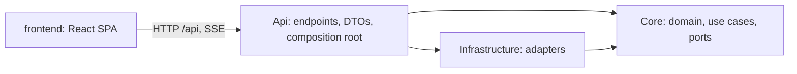
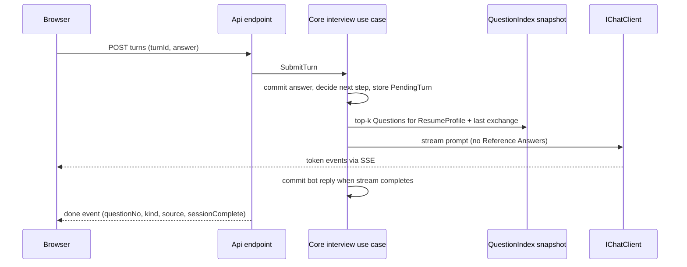
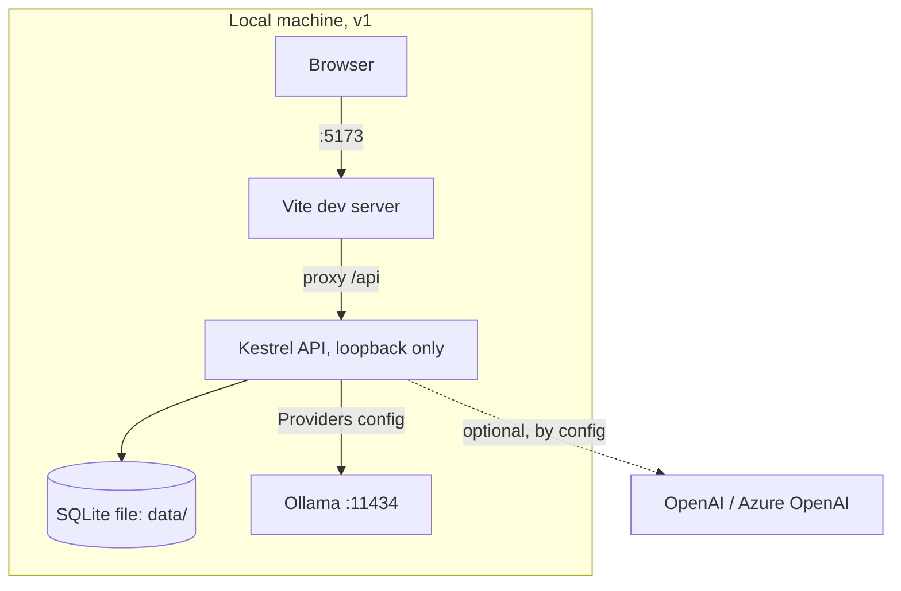
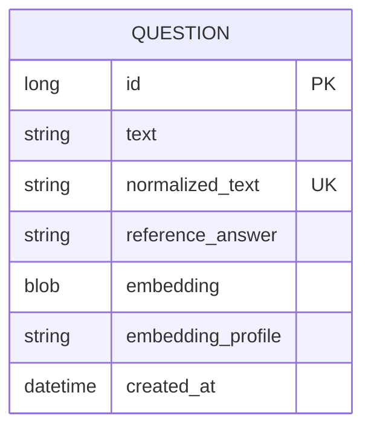

# Architecture Spine — ai-interview-prep-bot

## Design Paradigm

**Hexagonal (ports and adapters) modular monolith.** Core holds the domain, the interview state machine and the ports. Infrastructure holds the adapters (model Providers, SQLite, document readers). Api holds HTTP endpoints, DTOs and the composition root. The React SPA is a separate deployable that talks only to `/api`.



Dependencies point inward only. Core references no ASP.NET, EF Core or provider SDK. Its only external dependency is `Microsoft.Extensions.AI` (the abstractions plus the typed `GetResponseAsync<T>` helpers).

## Invariants & Rules

### AD-1 — Dependency direction and layer contents

- **Binds:** all backend code
- **Prevents:** business logic in endpoints; EF, OllamaSharp or OpenAI types leaking into use cases; model calls that cannot be tested
- **Rule:** Projects `InterviewPrepBot.Core`, `.Infrastructure`, `.Api`. Allowed references: Api → Infrastructure, Api → Core, Infrastructure → Core. Core never references the other two and takes no NuGet dependency beyond `Microsoft.Extensions.AI`. Endpoints only parse HTTP, call one Core use case, and map the result to a DTO. Ports are interfaces declared in Core and implemented in Infrastructure.

### AD-2 — Providers are the Microsoft.Extensions.AI abstractions `[ADOPTED]`

- **Binds:** FR-9, FR-5, FR-8, FR-10
- **Prevents:** provider SDK types in Core; a provider swap that needs code changes
- **Rule:** All model calls go through `IChatClient` and `IEmbeddingGenerator<string, Embedding<float>>`. These are the provider ports; no wrapper interface duplicates them. The chat Provider and the embedding Provider are chosen independently by configuration (`Providers:Chat:Type`, `Providers:Embedding:Type`) and constructed in one place, the Api composition root. v1 adapters: `ollama` (default, via OllamaSharp) and `openai` (Microsoft.Extensions.AI.OpenAI, which also covers Azure OpenAI and OpenAI-compatible endpoints through `Endpoint`; for Azure OpenAI `Endpoint` must be the resource's `/openai/v1/` URL). Adding a Provider is an Infrastructure adapter plus a config value, nothing else.

### AD-3 — The interview flow is a state machine in Core

- **Binds:** FR-5, FR-6, FR-7
- **Prevents:** a model that never ends the session, skips the Question Bank, or follows up twice; a deleted Question still being asked
- **Rule:** Core owns question count, source mix, the follow-up cap and session end. The model only writes wording or fills a typed structured output. At session creation Core fixes a slot plan: one source per slot (`resume` or `bank`), `Interview:QuestionCount` slots (default 10). Bank state (AD-8) `Ready` means at least one `resume` and one `bank` slot; `Empty` means all slots are `resume`. A `bank` slot's Question is selected lazily when its turn is generated, never at session creation, so a Question deleted mid-session is never asked (FR-3). At most one follow-up per Question, and a follow-up does not advance the count. `questionNo` is the 1-based slot number; a follow-up shares its parent's `questionNo`. Every asked Question is snapshotted into the transcript with its text and Reference Answer, so coaching still works if it is deleted afterwards. Behavioral Questions are `resume` slots.

### AD-4 — Sessions live on the server, in memory, with named data classes

- **Binds:** FR-4, FR-7, FR-8, NFR-resume-deleted
- **Prevents:** the Resume reaching disk, logs or browser storage; orphaned Resumes; a report Retry with no transcript
- **Rule:** `ISessionStore` (singleton, in-memory) holds each session. Each data class has one purge point:

  | Data | Purged when |
  | --- | --- |
  | Resume text and ResumeProfile | the interview ends (closing turn, End, delete or expiry), whichever is first |
  | Transcript (answers, asked-Question snapshots) and cached Coaching Report | the session is deleted or expires |

  `DELETE /api/interview/sessions/{id}` removes a session (idempotent, 204). The client calls it on "Start new Interview Session" and, best effort, on `pagehide` (`fetch` with `keepalive`). Backstop: idle expiry `Sessions:IdleMinutes` (default 60), refreshed by every request; an in-flight operation holds a lease that expiry never breaks. The client keeps only `sessionId` and rendered messages, so a reload ends the session. The ResumeProfile is one structured call made during session creation; if it fails no session exists. Resume text and ResumeProfile are never written to SQLite, files or logs.

### AD-5 — Turn protocol: single flight, idempotent by `turnId`

- **Binds:** FR-5, FR-6, FR-7, UX Stop/Retry
- **Prevents:** duplicate or half-written turns after Stop, failure, Retry or double-submit; a Retry that re-decides and double-advances
- **Rule:** Each session has a per-session lock: a second turn, report or end request while one is running gets `409 session-busy`. A request in the wrong state gets `409 invalid-session-state`. A turn request carries a client-generated `turnId` (GUID); `answer` is omitted only for the first turn of a session. On a new `turnId` the server commits the answer, runs the state machine, stores a `PendingTurn { turnId, decision }` and streams. When the stream completes it commits the bot reply, advances counters and clears `PendingTurn`. A failed or aborted stream keeps the committed answer and `PendingTurn`. Retry is the same request with the same `turnId`: while `PendingTurn` matches, the stored decision is replayed and only the wording is regenerated. A `turnId` equal to the last completed turn re-streams the stored reply with no model call. Stop is the client aborting the request; the `CancellationToken` must reach the model call. After the last planned Question is answered, the next turn is a closing turn with fixed Core text and no model call; it ends the interview.

### AD-6 — API contract and streaming

- **Binds:** all endpoints, all frontend calls, NFR-streaming
- **Prevents:** the SPA and API inventing different shapes; three streaming styles
- **Rule:** REST JSON under `/api`, camelCase, ISO-8601 UTC. Ids: bank Question `id` is a JSON number, `sessionId` an opaque string. The table below is the contract; any change to it is an AD change. Chat turns stream as `text/event-stream` from a POST using `TypedResults.ServerSentEvents`, read on the client with `fetch` and a `ReadableStream` (`EventSource` is GET-only). Every SSE `data:` field is JSON. Each event is an `SseItem` whose event type is the name below. Events: `token` `{ text }`, `done` `{ questionNo, plannedCount, kind, source, sessionComplete }`, `error` `{ type }`. `kind` is `question`, `follow-up` or `closing`; `source` is `resume`, `bank` or `null`. Failures before the stream starts are HTTP ProblemDetails; failures after it starts are an `error` event. Fixed user-facing copy is owned by the frontend and driven by DTO flags, not by server text.

  | Method and path | Request | Success response |
  | --- | --- | --- |
  | `GET /api/question-bank` | none | `{ count, questions: [{ id, text, referenceAnswer }] }` |
  | `POST /api/question-bank/questions` | `{ text, referenceAnswer? }` | 201 `{ id, text, referenceAnswer }` |
  | `DELETE /api/question-bank/questions/{id}` | none | 204, also when already gone |
  | `POST /api/question-bank/import` | multipart `file` | `{ found, added, alreadyInBank: [text], unreadable: [{ location, reason }] }` |
  | `POST /api/admin/re-embed` | none | `{ reembedded }` |
  | `POST /api/interview/sessions` | multipart `resume` | 201 `{ sessionId, plannedCount, bankState }` |
  | `POST /api/interview/sessions/{id}/turns` | `{ turnId, answer? }` | SSE stream (above) |
  | `POST /api/interview/sessions/{id}/end` | none | `{ answeredCount }` |
  | `POST /api/interview/sessions/{id}/report` | none | Coaching Report (AD-11); repeat calls return the cached report |
  | `DELETE /api/interview/sessions/{id}` | none | 204, also when already gone |

### AD-7 — One SQLite file, one writer, migrations at startup

- **Binds:** FR-1, FR-2, FR-3, FR-10
- **Prevents:** two components mutating Questions; schema drift between machines
- **Rule:** Persistence is a single SQLite file through EF Core. `Storage:Path` (default `data/interview-prep.db` under the repository root) is resolved to an absolute path at startup and logged. The file is git-ignored; a backup is a file copy with the API stopped. The schema is managed by EF Core migrations applied at startup. Only `IQuestionBank`, a Core port, writes Questions. Table `question`: `id` (integer, autoincrement), `text`, `normalized_text` (unique), `reference_answer` (nullable), `embedding` (float32 BLOB, nullable), `embedding_profile` (nullable), `created_at` (UTC, mapped through a value converter so `DateTimeKind` is `Utc` on read). Deleting a Question deletes its row.

### AD-8 — Retrieval over one versioned index snapshot

- **Binds:** FR-3, FR-5, FR-10
- **Prevents:** a stale cache asking deleted Questions; two meanings of "empty"; a vector database dependency
- **Rule:** `IQuestionBank` owns an immutable `QuestionIndex` snapshot (version number, entries of id, text and vector for rows matching the configured embedding profile, and a state). Every write replaces the snapshot atomically after the database commit. `IQuestionRetriever` is a pure function over a snapshot: cosine similarity, top-k, excluding already-asked Questions. `QuestionBankState` is the only definition of empty: `Empty` (no rows), `Ready` (at least one row matches the profile), `NotIndexed` (rows exist, none match). Session creation with `NotIndexed` waits for one reconcile (AD-9); if it is still `NotIndexed`, it fails with `provider-unavailable`. Only Question text is embedded. Reference Answers are never embedded and never enter interview-turn prompts. Retrieval queries are built from the ResumeProfile and the latest exchange.

### AD-9 — Embedding profile and single reconciler

- **Binds:** FR-10, FR-9
- **Prevents:** silently wrong retrieval after an embedding Provider change; two re-embed jobs racing
- **Rule:** The profile string is `{providerType}:{model}:{dimensions}:{promptScheme}` (for example `ollama:nomic-embed-text:768:nomic-v1`) and is produced only by Infrastructure. `IEmbeddingReconciler` is the single owner of re-embedding: it re-embeds every row whose profile differs from the configured one, one run at a time. It runs at startup and from `POST /api/admin/re-embed`; both call the same instance. There is no UI for it in v1.

### AD-10 — Provider quirks stay in Infrastructure

- **Binds:** FR-9, FR-10
- **Prevents:** model-specific prefixes or dimensions leaking into Core
- **Rule:** Core embeds through `IQuestionEmbedder`, passing plain text and an intent (`document` or `query`). Model-specific handling, such as the `search_document:` and `search_query:` prefixes `nomic-embed-text` needs, lives in an Infrastructure decorator over `IEmbeddingGenerator`, which also sets the `promptScheme` part of the profile.

### AD-11 — Machine-read model output is typed, schema-constrained and validated

- **Binds:** FR-8, FR-5
- **Prevents:** regex-parsing chat prose; a Coaching Report whose shape or evidence varies by model
- **Rule:** Any output the code reads uses `IChatClient.GetResponseAsync<T>` with `T` a Core record. The Coaching Report record holds `endedEarly`, `answeredCount`, `summary`, strengths, weak spots and per-Question reviews; each review has a `basis` (`reference` or `rubric`), and each strength and weak spot carries `questionNo` and a short quote. There is no numeric score. A deterministic Core validator rejects a report unless it has at least one strength and one weak spot, every `questionNo` names an answered Question, and every quote appears in that answer (whitespace, case and straight-versus-curly quote characters ignored, because constrained output can alter quotes). A schema or validator failure gets one retry, then `invalid-model-output`.

### AD-12 — Prompt budgets

- **Binds:** FR-8, FR-5, NFR-16GB
- **Prevents:** silently truncated prompts on a small local model; long Reference Answers flooding context
- **Rule:** The chat adapter sets the model context size explicitly from `Providers:Chat:ContextTokens` (default 8192, sent to Ollama as `num_ctx`) instead of relying on a Provider default. An interview-turn prompt holds the system prompt, the Resume text or ResumeProfile, the current slot's Question text (bank Question text only, never its Reference Answer) and the last `Interview:HistoryTurns` transcript entries (default 6). A Resume longer than `Interview:MaxResumeChars` (default 12000) is rejected with `file-too-large`. A coaching prompt holds at most one Reference Answer. The report is one structured review call per answered Question (with that Question's Reference Answer, or the rubric when none exists; situation, action, result for behavioral), then one synthesis call over the per-Question reviews. Completed per-Question reviews are cached in the session, so a report Retry redoes only the failed calls. Untrusted text (Resume, answers, imported text) is placed in delimited blocks in prompts and never treated as instructions.

### AD-13 — Document extraction and import parsing

- **Binds:** FR-1, FR-4
- **Prevents:** style-dependent parsing; silent data loss on import; trusting client-supplied file types
- **Rule:** `IDocumentTextExtractor` is a Core port taking the file and an `AllowedKinds` set, with Infrastructure adapters (Word: DocumentFormat.OpenXml; PDF: PdfPig; plain text: UTF-8). The type is detected from content, not from the client content-type: `%PDF-` for PDF, a zip containing `word/document.xml` for Word, valid UTF-8 without NUL bytes for text. A Resume allows Word and PDF only; import allows Word, PDF and text. Output is plain text, one paragraph per line; the PDF adapter uses PdfPig's `ContentOrderTextExtractor` because `Page.Text` carries no line breaks, and PDF line structure is best effort. No text is an `unreadable-document` error. Import parsing is a pure Core function over that text: a Question starts at a line beginning `Q<number>.`; the stored Question text is the rest of that line with the `Q<number>.` removed; the answer is the trimmed text up to the next Question, paragraph breaks kept as newlines; text before the first Question is ignored. A `Q<number>.` line with no text after it goes into `unreadable` with its line number as `location`. Numbers need not be sequential. Wrapped lines in PDF and text files are best effort. A test pins the committed copy of the sample bank at 87 Questions, each with a Reference Answer.

### AD-14 — Import and add semantics `[ASSUMPTION]`

- **Binds:** FR-1, FR-2
- **Prevents:** duplicate Questions on re-import; half-imported files; a locked database on concurrent imports
- **Rule:** One function, `QuestionText.Normalize` (trim, collapse whitespace, case-fold), is used by the parser, single add and the unique index. Import and single add embed first, outside any database transaction, then insert in one transaction with `ON CONFLICT DO NOTHING` on `normalized_text`. Rows that conflict, whether existing, duplicated within the file or from a concurrent import, are counted as `alreadyInBank`. If embedding fails nothing is saved and the API returns a retryable error. Single add of an existing Question returns `409 duplicate-question`. `found` is the number of Questions the parser recognised, so the UI shows "No Questions found." only when `found` is 0. Uploads over `Uploads:MaxBytes` (default 10 MB) are rejected before parsing with `file-too-large`.

### AD-15 — Error shape

- **Binds:** all endpoints, all frontend calls
- **Prevents:** per-endpoint error formats; raw exception text reaching users; one slug carrying two meanings
- **Rule:** Errors are RFC 9457 ProblemDetails with a stable `type` slug: `provider-unavailable` (Provider unreachable, refused or timed out), `invalid-model-output` (Provider answered but the output failed schema or validation), `unreadable-document`, `unsupported-file-type`, `file-too-large`, `session-not-found`, `session-busy`, `invalid-session-state`, `duplicate-question`, `invalid-request`. The frontend maps each slug to its own copy; `EXPERIENCE.md` gains copy for the slugs it does not yet cover. Exception text is logged without content (AD-17) and never returned.

### AD-16 — Frontend structure and state ownership `[ADOPTED]`

- **Binds:** UX routes, FR-1 to FR-8 UI
- **Prevents:** a chat that dies when the user changes route; three styles of data fetching; CORS and absolute-URL drift; a UI kit hiding CSS the user wants to learn
- **Rule:** React + TypeScript + Vite scaffolded with `npm create vite@latest -- --template react-ts`, then `react-router`, Vitest and React Testing Library added by hand, for the routes in `EXPERIENCE.md`, hand-rolled CSS on the `DESIGN.md` tokens. No UI kit and no server-state library in v1. One `InterviewProvider` above `<Routes>` owns `sessionId`, messages, the in-flight `AbortController` and the report; leaving a route never aborts a stream. `src/api/` holds one function per row of the AD-6 table, using relative `/api/...` URLs only, and `src/api/types.ts` is the single hand-written mirror of the DTOs. POST turns are never retried automatically; the user's Retry re-sends the same `turnId`. In dev, Vite proxies `/api` to Kestrel, so CORS is never configured.

### AD-17 — Secrets, exposure and logging

- **Binds:** NFR-secrets, NFR-resume-deleted
- **Prevents:** keys in the browser or repo; an unauthenticated API reachable from the network or a hostile web page; personal content in logs
- **Rule:** API keys come from .NET user-secrets in development and environment variables elsewhere, bound to validated options (`ValidateOnStart`). No endpoint returns configuration. In v1 Kestrel binds to loopback only, `AllowedHosts` is `localhost`, and every non-GET request must carry an `Origin` listed in `Security:AllowedOrigins` or is rejected with `403 invalid-request`. Resume text, ResumeProfile, answers, imported text and Reference Answers are never logged, and request logging never records bodies. With a hosted Provider those texts leave the machine; that is documented in the README and not blocked. v1 model calls use no tools, and model output is rendered as plain text only.

### AD-18 — Test seam

- **Binds:** all backend and frontend code
- **Prevents:** flaky or slow tests that need a running model or backend
- **Rule:** Backend automated tests use fake `IChatClient` and `IEmbeddingGenerator` implementations and never call a real model; live-model checks are separate and opt-in. Frontend tests run against a mocked `src/api` module. The PRD testable consequences are covered by these tests, including the AD-13 sample-bank test.



## Consistency Conventions

| Concern | Convention |
| --- | --- |
| C# naming | Namespaces `InterviewPrepBot.<Project>[.<Area>]`; file-scoped namespaces; nullable enabled; DTOs and model outputs are `record`s; ports are `I`-prefixed in Core; adapters are named for the technology (`OllamaChatClientFactory`, `SqliteQuestionBank`) |
| C# structure | Core areas: `Interview`, `QuestionBank`, `Coaching`, `Documents`, `Providers`; prompts live in `Core/Interview/Prompts` and `Core/Coaching/Prompts`, never inline in endpoints |
| Config | `appsettings.json` plus user-secrets; sections `Providers:Chat`, `Providers:Embedding` (each `Type`, `Model`, `Endpoint`, `ApiKey`, chat also `ContextTokens`), `Interview`, `Sessions`, `Storage`, `Uploads`, `Security` |
| Frontend naming | Components `PascalCase.tsx`; feature folders `src/features/interview`, `src/features/question-bank`; shared code in `src/ui`, `src/api` |
| Identifiers and dates | Bank Question `id` integer; transcript and report use `questionNo`; `turnId` GUID; UTC ISO-8601 |
| Errors | ProblemDetails per AD-15; the frontend shows its own copy, not `detail` |
| State | Server: sessions in memory (AD-4), Question Bank in SQLite (AD-7). Client: React state and Context (AD-16); `localStorage` only for theme and the question-type switch, always in try/catch |
| Cancellation | Every async Core method and every model call accepts and forwards a `CancellationToken` |
| Logging | `ILogger` with message templates; log ids, counts and slugs, never content (AD-17) |

## Stack

| Name | Version |
| --- | --- |
| .NET SDK / target framework | 10.0.401 / net10.0 |
| ASP.NET Core minimal APIs | 10.0 |
| Microsoft.Extensions.AI and .Abstractions | 10.10.0 |
| OllamaSharp | 5.4.30 |
| Microsoft.Extensions.AI.OpenAI | 10.10.0 |
| Microsoft.EntityFrameworkCore.Sqlite | 10.0.12 |
| DocumentFormat.OpenXml | 3.5.1 |
| PdfPig | 0.1.16 |
| xunit.v3 | 4.0.1 |
| Node.js / npm | 24 LTS, latest patch (installed 24.11.1) / 11.6.2 |
| React and react-dom | 19.3.0 |
| TypeScript | ~6.0.2 (create-vite pin; 7.0.2 also verified to build) |
| Vite / @vitejs/plugin-react | 8.3.0 / 6.1.1 |
| react-router | 8.4.0 |
| Vitest | 5.0.1 |
| Ollama (local runtime, not yet installed) | 0.34.2 |
| Default chat model | gemma3:4b (fit on a 4 GB GPU unconfirmed) |
| Default embedding model | nomic-embed-text (768 dimensions) |

## Structural Seed





Session, ResumeProfile, transcript and Coaching Report are in-memory records, not tables.

```text
ai-interview-prep-bot/
  backend/
    InterviewPrepBot.slnx
    src/InterviewPrepBot.Core/            # ports, interview state machine, import parser, prompts
    src/InterviewPrepBot.Infrastructure/  # ollama/openai factories, sqlite bank, extractors
    src/InterviewPrepBot.Api/             # endpoints, DTOs, composition root, options
    tests/InterviewPrepBot.*.Tests/       # tests/fixtures holds the sample bank copy
  frontend/                               # Vite react-ts app: src/api, src/features, src/ui
  data/                                   # SQLite file (git-ignored)
  docs/
```

## Capability → Architecture Map

| Capability / Area | Lives in | Governed by |
| --- | --- | --- |
| FR-1 Import Questions | Core `QuestionBank` + `Documents`; Infrastructure extractors; Api import endpoint | AD-7, AD-13, AD-14 |
| FR-2 Add a Question | Core `QuestionBank`; Api | AD-7, AD-14 |
| FR-3 View and delete | Core `QuestionBank`; Api | AD-3, AD-7, AD-8 |
| FR-4 Upload a Resume | Core `Interview`, `Documents`; Api sessions endpoint | AD-4, AD-12, AD-13 |
| FR-5 Mixed Questions | Core `Interview` + `IQuestionRetriever` | AD-3, AD-8, AD-12 |
| FR-6 Follow-ups | Core `Interview` | AD-3, AD-5 |
| FR-7 End the session | Core `Interview`; Api | AD-3, AD-4, AD-5 |
| FR-8 Coaching Report | Core `Coaching` | AD-11, AD-12 |
| FR-9 Provider choice | Api composition root; Infrastructure factories | AD-2, AD-10, AD-17 |
| FR-10 Re-embed | Core `IEmbeddingReconciler`; Api admin endpoint | AD-9, AD-10 |
| NFR streaming | Api turn endpoint; frontend `src/api` | AD-5, AD-6 |
| NFR Resume deleted, secrets | Core `ISessionStore`; Api options | AD-4, AD-17 |
| Frontend routes and components | `frontend/src` | AD-16, `EXPERIENCE.md`, `DESIGN.md` |

## Deferred

- **Follow-up decision mechanism** (extra structured call versus one prompt), the `resume`-to-`bank` slot ratio and the hang threshold: tune during build; AD-3 and AD-5 already bound the outcome.
- **Anthropic adapter and a hosted-API fallback** (PRD open question 1): revisit if local coaching quality proves too weak; AD-2 keeps the path open.
- **Hosting, the production build and how the SPA is served, authentication and the shared editable Question Bank** (PRD open question 2): revisit at the hosting stage, before any public deployment. AD-17 keeps v1 loopback-only until then.
- **Copy for the new error slugs** (`session-busy`, `invalid-session-state`, `duplicate-question`, `invalid-model-output`, `file-too-large` for Resumes): add to `EXPERIENCE.md` when the first story that can raise each one is written.
- **Search or paging past about 100 Questions, saveable Coaching Reports, editing a Question, tagging**: out of v1 per PRD and UX.
- **OpenAPI-generated frontend types**: revisit if hand-written `types.ts` drifts from the AD-6 table.
- **CI, packaging, Docker, telemetry beyond logs**: not needed for a local learning build.
- **Learning commentary** for build agents: configure with `bmad-customize` before the build stage (PRD addendum).
- **Ollama model pull and warm-up automation**: the first-run steps go in the repo README, including an `ollama ps` check that the chat model fits the GPU, with `qwen3:4b` or a smaller model as the fallback.
